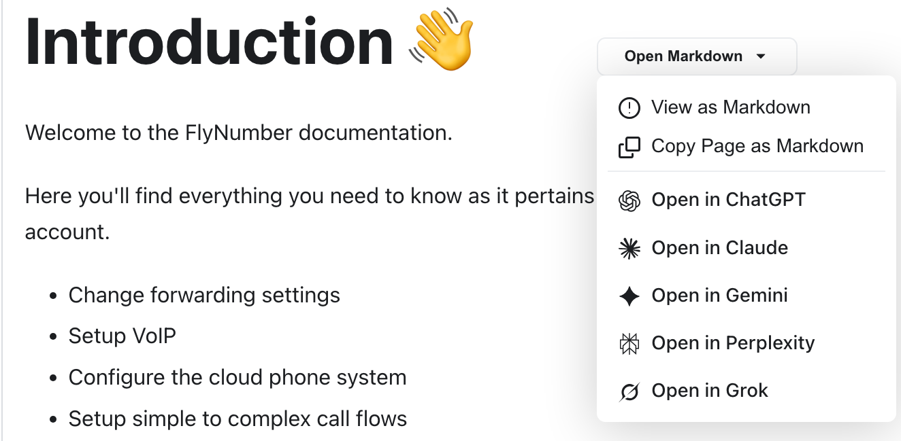
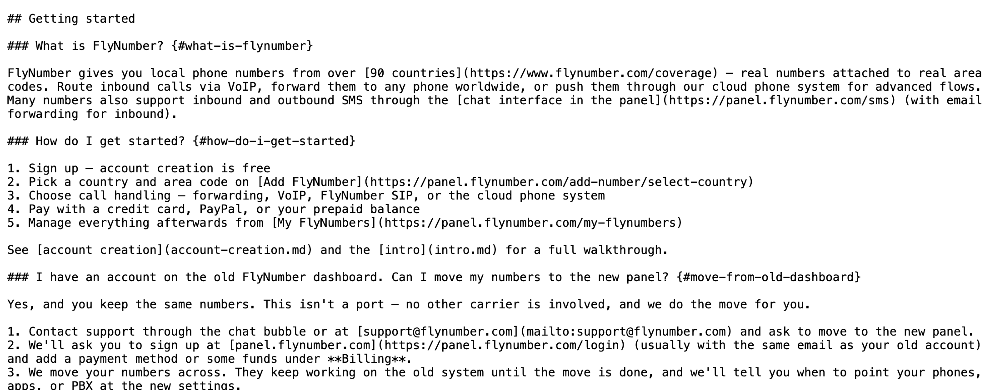
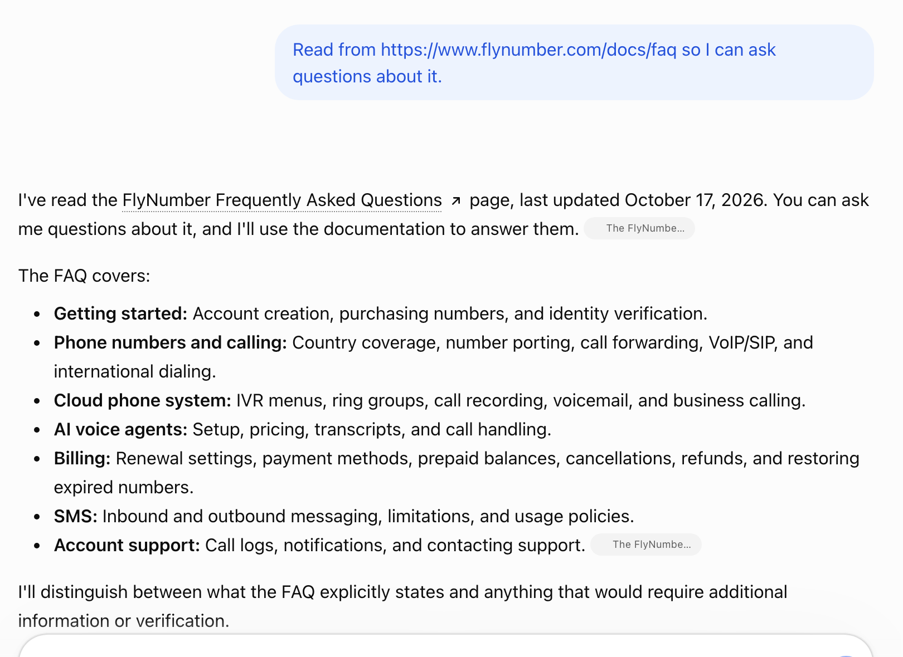

# Docusaurus Markdown Source Plugin

[](https://www.npmjs.com/package/docusaurus-markdown-source-plugin)
[](https://opensource.org/licenses/MIT)

A Docusaurus plugin that publishes a clean markdown copy of every docs page next to the HTML (`/docs/intro` → `/docs/intro.md`) and adds an **Open Markdown** dropdown to each page with:

- View as Markdown
- Copy Page as Markdown
- Open in ChatGPT, Claude, Gemini, Perplexity and Grok, each with a prompt that points the assistant at the page

The markdown is generated at build time from your source files, with front matter, MDX imports, React components and `<Tabs>`/`<details>` blocks turned into plain markdown that an LLM can read as-is. No runtime dependencies beyond `fs-extra`, no swizzling, zero configuration.

See it running at [flynumber.com/docs](https://www.flynumber.com/docs/).



## Install

```bash
npm install docusaurus-markdown-source-plugin
```

Add it to `docusaurus.config.js` (or `.ts`):

```javascript
module.exports = {
  plugins: ['docusaurus-markdown-source-plugin'],
};
```

Then build. The dropdown appears on every doc page under `/docs/`, and the `.md` files are written into the build output next to the HTML.

### Dropdown layout CSS (recommended)

The dropdown is injected into the article header. These rules in `src/css/custom.css` put it on the right of the title and keep the menu inside the viewport on phones:

```css
article .markdown header {
  display: flex;
  align-items: center;
  flex-wrap: wrap;
  gap: 1rem;
  overflow: visible;
}

article .markdown header h1 {
  flex: 1 1 auto;
  margin: 0;
}

.markdown-actions-container {
  flex-shrink: 0;
  margin-left: auto;
  position: relative;
}

.markdown-actions-container .dropdown__menu {
  z-index: 1000;
  min-width: 220px;
  left: 0;
  right: auto;
}

.dropdown__link:hover {
  background-color: var(--ifm-hover-overlay);
}

@media (max-width: 768px) {
  .markdown-actions-container {
    margin-bottom: 1rem;
  }
  .markdown-actions-container .dropdown__menu {
    left: auto;
    right: 0;
    max-width: calc(100vw - 2rem);
  }
}

[dir="rtl"] .markdown-actions-container {
  margin-left: 0;
  margin-right: auto;
}
```

## What readers get

**View as Markdown** opens the generated `.md` in a new tab:



**Open in ChatGPT** (and the other assistants) opens the assistant with the prompt already filled in. Here ChatGPT has read the FAQ page and is ready for questions:



## How it works

- **Build time.** `postBuild` walks the Docusaurus route tree and, for every route with a markdown source, writes a cleaned `.md` into the build directory and copies the doc's `img/` folders. Custom `routeBasePath`, versioned docs and i18n are handled through the route metadata, not by scanning the filesystem. Routes ending in `/` become `index.md`.
- **Runtime.** The plugin's `Root` wrapper injects the dropdown into `article .markdown header` on pages under `docsPath`. The dropdown builds its links from the current URL, so no page data is needed.
- **Assistant links.** Each row opens the assistant's new-chat URL with the prompt `Read from {url} so I can ask questions about it.` ChatGPT and Claude receive the `.md`; Gemini, Perplexity and Grok receive the HTML page URL. See [Options](#options) for why.
- **Discoverability.** Every page that has a twin gets `<link rel="alternate" type="text/markdown" href="…">` in its built HTML, the convention Mintlify, Anthropic, Bun and Cloudflare docs use, and the build root gets an `llms.txt` listing every twin with its title (`/docs/llms.txt` on a `/docs/` site). Together with the per-bot header below, AI search crawlers can find and index the markdown while Google and Bing keep ignoring it.

## Options

```javascript
module.exports = {
  plugins: [
    ['docusaurus-markdown-source-plugin', {
      docsPath: '/docs/',
      aiProviders: ['chatgpt', 'claude', 'gemini', 'perplexity', 'grok'],
      aiPrompt: 'Read from {url} so I can ask questions about it.',
      llmsTxt: true,
    }],
  ],
};
```

| Option | Default | What it does |
|--------|---------|--------------|
| `docsPath` | `'/docs/'` | URL prefix of the pages that get the dropdown. Use `'/'` for a docs-only site (`routeBasePath: '/'`). |
| `aiProviders` | all five, in this order | Which assistant rows to show, in menu order. `[]` or `false` hides the rows. Accepts built-in ids and custom entries (below). |
| `aiPrompt` | `'Read from {url} so I can ask questions about it.'` | The prompt the assistant receives. Must contain `{url}`. |
| `llmsTxt` | `true` | Write `llms.txt` at the build root listing every twin. Set `false` if another plugin already generates one. |

Invalid values fail `docusaurus build` with a message naming the option.

### Built-in assistants

| id | Row | URL in the prompt |
|----|-----|-------------------|
| `chatgpt` | Open in ChatGPT | `.md` copy |
| `claude` | Open in Claude | `.md` copy |
| `gemini` | Open in Gemini | HTML page |
| `perplexity` | Open in Perplexity | HTML page |
| `grok` | Open in Grok | HTML page |

ChatGPT and Claude fetch whatever URL they are given, so they get the clean markdown; in testing, ChatGPT requested the `.md` live and answered from it. Perplexity and Google AI Mode answer from their search index instead of fetching, and the `.md` copies are never in any index because the headers below mark them `noindex`, so those two get the HTML page they already know. Grok is untested and gets the page as the safe choice. "Open in Gemini" opens Google's AI Mode, since gemini.google.com has no way to prefill a prompt from a link.

The assistant fetches the page itself, so the site has to be publicly reachable. On `localhost`, password-protected previews or private sites the rows open but the assistant cannot read the page. Claude asks for sign-in first; Grok asks the reader to confirm the prefilled message.

### Custom assistants

```javascript
aiProviders: [
  'chatgpt',
  'claude',
  { label: 'Open in Mistral', url: 'https://chat.mistral.ai/chat?q={prompt}' },
],
```

A custom entry has a `label`, a `url` template containing `{prompt}` (the URL-encoded prompt is substituted in), and optionally `context: 'markdown'` to hand it the `.md` URL instead of the HTML page. Custom entries get a generic icon.

## Serving the .md files

The build writes plain files, so any static host serves them. Two headers are worth setting: `Content-Type: text/plain` so browsers display rather than download, and a per-bot `X-Robots-Tag` that keeps Google, Bing and DuckDuckGo from indexing a second copy of every page while leaving AI search crawlers (PerplexityBot, OAI-SearchBot, ClaudeBot and the rest) free to index the markdown. A blanket `noindex, nofollow` would hide the twins from the AI search engines as well, which defeats the point; assistants that fetch a URL live are unaffected either way.

<details>
<summary>Vercel (<code>vercel.json</code>)</summary>

```json
{
  "headers": [
    {
      "source": "/(.*)\\.md",
      "headers": [
        { "key": "Content-Type", "value": "text/plain; charset=utf-8" },
        { "key": "X-Content-Type-Options", "value": "nosniff" },
        { "key": "X-Robots-Tag", "value": "googlebot: noindex, nofollow, bingbot: noindex, nofollow, duckduckbot: noindex, nofollow" },
        { "key": "Cache-Control", "value": "public, max-age=3600, must-revalidate" }
      ]
    },
    {
      "source": "/docs/(.*)/img/(.*)",
      "headers": [
        { "key": "X-Robots-Tag", "value": "googlebot: noindex, nofollow, bingbot: noindex, nofollow, duckduckbot: noindex, nofollow" },
        { "key": "Cache-Control", "value": "public, max-age=86400, immutable" }
      ]
    }
  ]
}
```
</details>

<details>
<summary>Netlify (<code>netlify.toml</code>)</summary>

```toml
[[headers]]
  for = "/*.md"
  [headers.values]
    Content-Type = "text/plain; charset=utf-8"
    X-Content-Type-Options = "nosniff"
    X-Robots-Tag = "googlebot: noindex, nofollow, bingbot: noindex, nofollow, duckduckbot: noindex, nofollow"
    Cache-Control = "public, max-age=3600, must-revalidate"

[[headers]]
  for = "/docs/*/img/*"
  [headers.values]
    X-Robots-Tag = "googlebot: noindex, nofollow, bingbot: noindex, nofollow, duckduckbot: noindex, nofollow"
    Cache-Control = "public, max-age=86400, immutable"
```
</details>

<details>
<summary>Cloudflare Pages (<code>_headers</code> in the build output)</summary>

```
/*.md
  Content-Type: text/plain; charset=utf-8
  X-Content-Type-Options: nosniff
  X-Robots-Tag: googlebot: noindex, nofollow, bingbot: noindex, nofollow, duckduckbot: noindex, nofollow
  Cache-Control: public, max-age=3600, must-revalidate

/docs/*/img/*
  X-Robots-Tag: googlebot: noindex, nofollow, bingbot: noindex, nofollow, duckduckbot: noindex, nofollow
  Cache-Control: public, max-age=86400, immutable
```
</details>

<details>
<summary>Apache (<code>.htaccess</code>)</summary>

```apache
<FilesMatch "\\.md$">
  Header set Content-Type "text/plain; charset=utf-8"
  Header set X-Content-Type-Options "nosniff"
  Header set X-Robots-Tag "googlebot: noindex, nofollow, bingbot: noindex, nofollow, duckduckbot: noindex, nofollow"
  Header set Cache-Control "public, max-age=3600, must-revalidate"
</FilesMatch>

<LocationMatch "^/docs/.*/img/.*">
  Header set X-Robots-Tag "googlebot: noindex, nofollow, bingbot: noindex, nofollow, duckduckbot: noindex, nofollow"
  Header set Cache-Control "public, max-age=86400, immutable"
</LocationMatch>
```
</details>

<details>
<summary>Nginx</summary>

```nginx
location ~* \.md$ {
  add_header Content-Type "text/plain; charset=utf-8";
  add_header X-Content-Type-Options "nosniff";
  add_header X-Robots-Tag "googlebot: noindex, nofollow, bingbot: noindex, nofollow, duckduckbot: noindex, nofollow";
  add_header Cache-Control "public, max-age=3600, must-revalidate";
}

location ~* ^/docs/.*/img/.* {
  add_header X-Robots-Tag "googlebot: noindex, nofollow, bingbot: noindex, nofollow, duckduckbot: noindex, nofollow";
  add_header Cache-Control "public, max-age=86400, immutable";
}
```
</details>

Check with `curl -I https://yourdomain.com/docs/intro.md` after deploying; purge the CDN cache if the old headers linger.

## Limits

- **Docs pages only.** The dropdown is injected into the docs article header. Blog posts render their header outside the markdown container, so they are not supported yet. Category and index pages have no markdown source, so they get no dropdown either.
- **One instance.** The plugin reads its own global data by the default plugin id; a second instance with a custom `id` is rejected at config time.
- **Markdown cleaning is regex-based.** Fenced code blocks are protected, but deeply nested same-name components are a known limitation.

## Troubleshooting

**Dropdown missing.** Confirm the plugin is in `plugins`, rebuild, and check that the page is under `docsPath`. In DevTools, `document.querySelector('article .markdown header')` must return an element; a theme that changes that structure needs a different injection point. If you ever copied the plugin's `Root` into `src/theme`, delete the copy: it shadows the plugin's and fails to build on its internal imports. To add your own `Root` logic, wrap `@theme-original/Root` instead.

**`.md` URLs return 404.** Look for `[markdown-source-plugin] Found N markdown routes` in the build log. Zero routes means the docs plugin is not providing `sourceFilePath` metadata; no line at all means the plugin did not run.

**Copy does nothing.** The Clipboard API needs HTTPS or `localhost`.

**Assistant rows open but the assistant cannot read the page.** The link uses the live origin, so on `localhost` the assistant receives a URL it cannot fetch. Deploy to a public URL to test end to end.

## Upgrading from 2.2.x

No config changes are needed; the assistant rows appear automatically. Set `aiProviders: []` to hide them. Trailing-slash routes map to `index.md` (since 2.2.5), so links to `intro.md` need updating.

## Contributing

Issues and pull requests are welcome at [github.com/FlyNumber/markdown_docusaurus_plugin](https://github.com/FlyNumber/markdown_docusaurus_plugin). Run `npm test` before opening a PR.

## License

MIT. Brand marks in the assistant rows come from [lobe-icons](https://github.com/lobehub/lobe-icons) (MIT); see `THIRD_PARTY_NOTICES.md`.

Built by [FlyNumber](https://www.flynumber.com), where it runs on [the docs](https://www.flynumber.com/docs/) and [the blog](https://www.flynumber.com/blog/).
